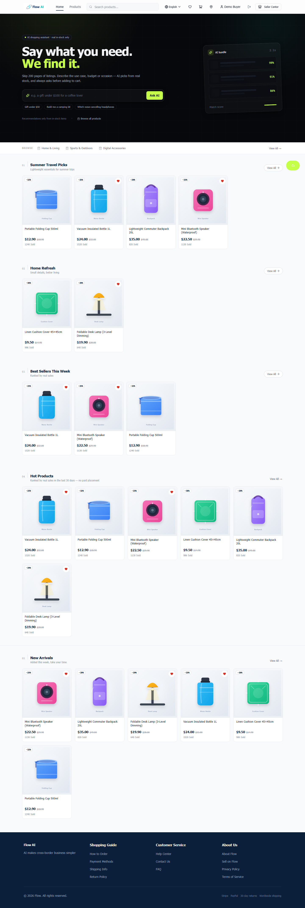
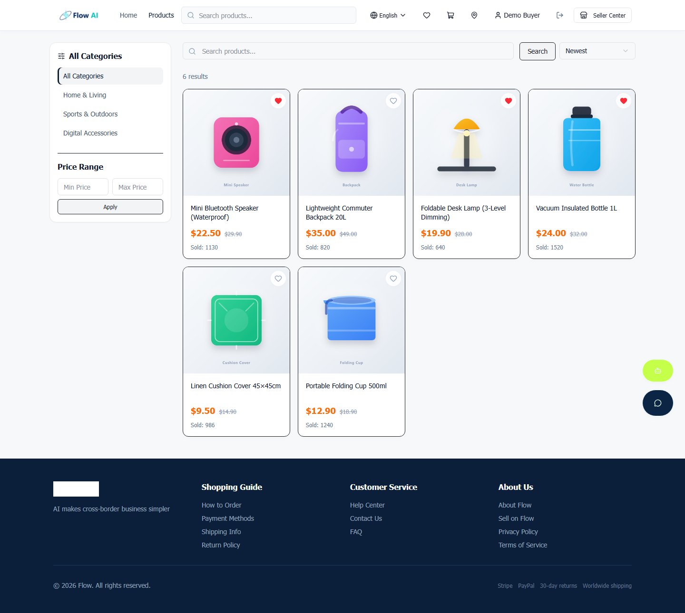
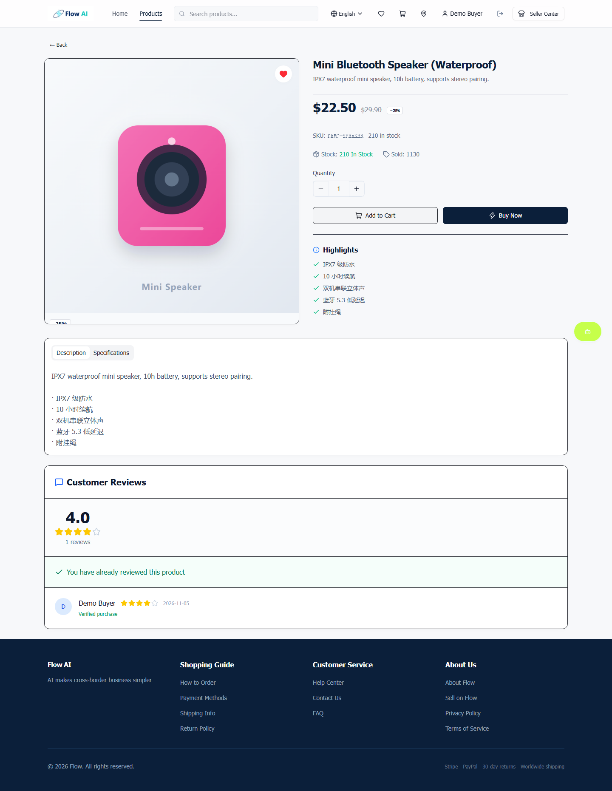
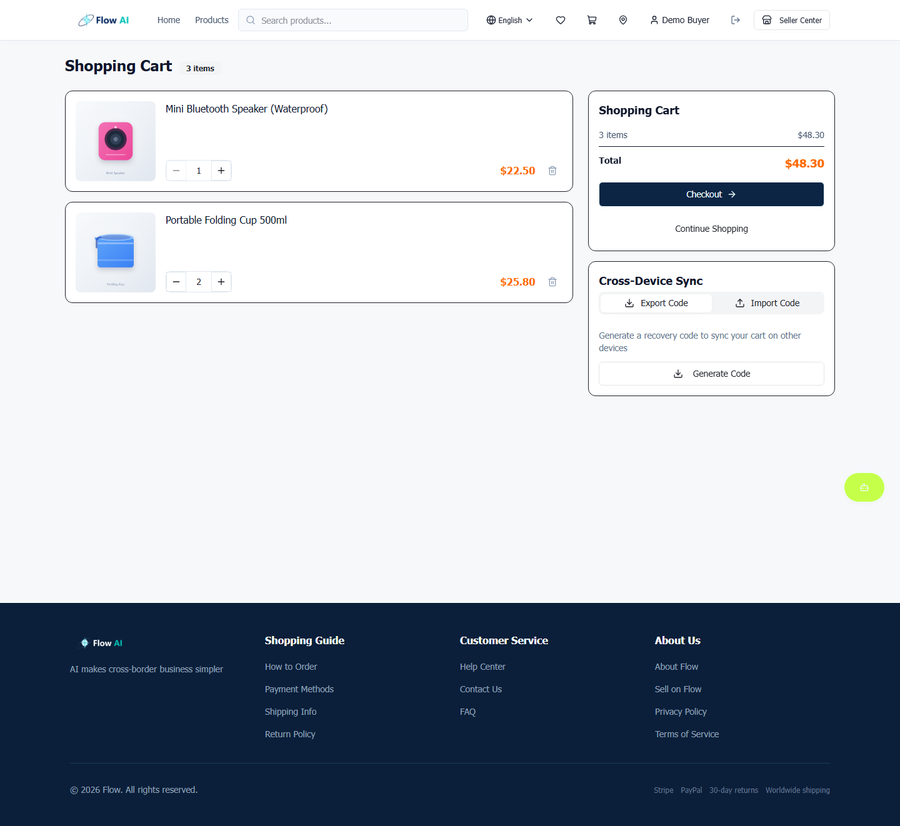
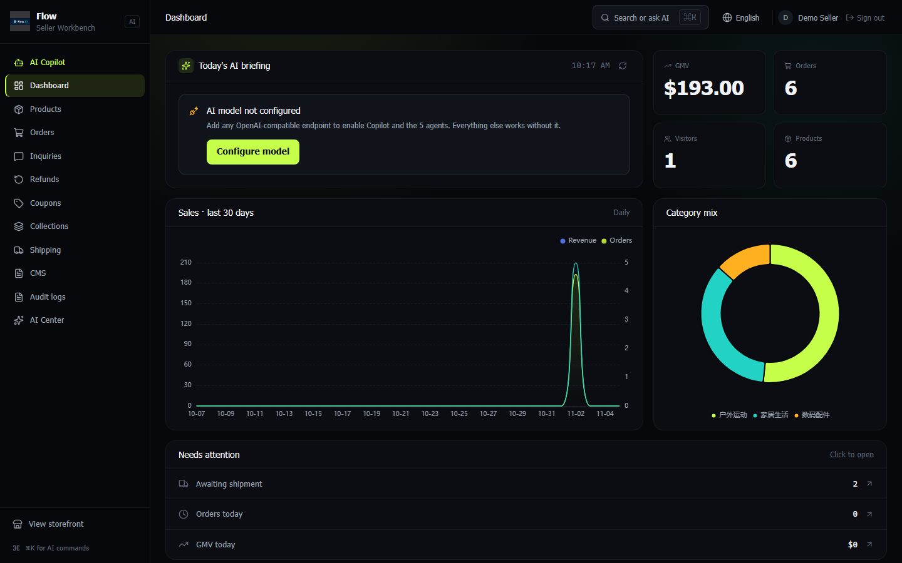
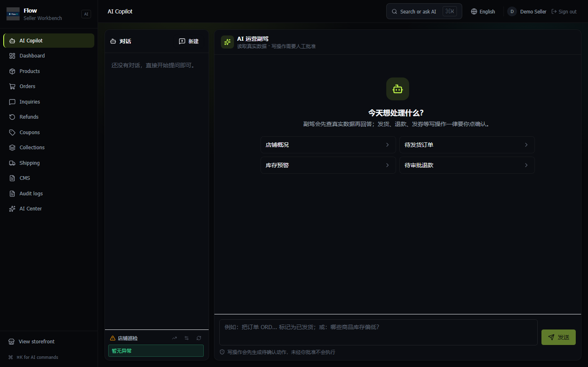

<div align="center">


# Flow

**跨境电商平台。买家商城 + 卖家 AI 工作台，一套代码。**

[](CHANGELOG.md)
[](LICENSE)
[](https://www.typescriptlang.org/)
[](https://react.dev/)
[](https://nestjs.com/)
[](server)

[**English**](README.md) · [**简体中文**](README.zh-CN.md)

[**70 秒演示**](docs/video/demo.mp4) · [**截图**](docs/screenshots) · [**架构**](docs/ARCHITECTURE.md) · [**部署**](docs/DEPLOY.md)

</div>



---

## 快速开始

```bash
git clone https://github.com/X33834/Flow.git && cd Flow
cp .env.example .env          # 填 JWT_SECRET 和 POSTGRES_PASSWORD
docker compose up -d --build
```

商城 → <http://localhost:3000> ｜ 卖家工作台 → <http://localhost:3000/seller/dashboard>

<details>
<summary>不用 Docker</summary>

```bash
npm ci && cp .env.example .env   # 设 DATABASE_URL、JWT_SECRET
npm run db:migrate
npm run dev                       # Vite + NestJS
```
</details>

---

## 三个真正的差异点

### 1. AI 能动手，但动手前必须问你

副驾会真的调用工具：查库存、改状态、批退款、发优惠券。**写操作永不自动执行**，只生成待审批卡片，卖家确认后才走正常业务服务。

12 个工具的风险等级由服务端单点声明，前端审批卡、MCP schema、OpenAPI 从同一份契约生成——不存在三处各写一遍导致漂移。

- 同会话同工具同参数只生成一张卡（幂等键 + 唯一索引）
- 审批 24 小时过期；进程崩溃留下的 `processing` 由 60 秒看门狗回收
- 工具定义变更后旧审批自动失效（`policy_snapshot` 指纹）

### 2. 跨境的价格是真的算过的

税不是占位符。`computeTax()` 按目的国规则算 VAT/GST 与关税，**结账页、下单、落库用同一个函数**：

| 市场 | VAT/GST | 关税起征点 | 备注 |
|---|---|---|---|
| DE / FR / IT / ES / NL | 19–22% | 150 EUR | EU IOSS，起征点只免关税，VAT 照收 |
| GB | 20% | £135 | 卖家代征 |
| JP | 10% | 10,000 JPY | 低值免征关税 |
| AU / SG / CA | 5–10% | — | 低值商品同样征收 |

未收录的国家返回 `status: unknown` 并明确提示「可能产生额外费用」，不会假装免税。税基是否含运费、折扣是否先扣减、起征点按折后货值判定——每条都有测试。

### 3. 库存不会被悄悄吃掉

下单即锁库存，但未支付订单**不会永久占用**：30 分钟（可配）后自动取消并回补库存与优惠券额度。状态用条件更新抢占，重复扫描不会把库存回补两次。

这一条比并发超卖更隐蔽——买家拍下不付款，库存就没了，而且没有任何报错。

---

## 其余能力

| | 买家 | 卖家 |
|---|---|---|
| 交易 | 搜索筛选、SKU 规格、购物车、优惠券、结账、物流、退款、评价 | 看板、商品、订单、退款、优惠券、集合、CMS、审计 |
| AI | 导购：描述需求 → 推荐真实在售商品 → 确认才加购 | 5 个 Agent（文案/客服/趋势/选品/翻译）+ 审批式副驾 |
| 接入 | — | MCP 只读端点 + Agent Card，写操作永不开放 |

**没有配 AI Key 也能跑。** 所有非 AI 功能正常，AI 接口返回明确的「未配置模型」，不编造数据。

---

## 截图

| 商城首页 | 商品列表 |
|---|---|
|  |  |
| **商品详情** | **购物车** |
|  |  |
| **卖家看板** | **AI 副驾** |
|  |  |

全部 31 张在 [`docs/screenshots/`](docs/screenshots)，由 `npm run capture:all` 对真实种子库生成。

---

## 工程

| 项 | 状态 |
|---|---|
| 类型 | TypeScript strict，前后端共享 `shared/api.interface.ts` |
| 规模 | 26 NestJS 模块 · 160 端点 · 39 表 · 11 迁移 |
| 测试 | **370 用例 / 54 文件** |
| E2E | 6 套跑真实 PostgreSQL：工作流、无 Key 降级、交易、渠道、副驾、导购 |
| 浏览器 QA | 30 条路由，桌面 + 移动，0 console 错误 / 0 失败请求 |
| CI | lint → typecheck → 单测 → 生产依赖审计 → 构建 → Postgres E2E |

---

## 架构

```
React 19 + Vite + Tailwind        NestJS 12 + Drizzle ORM
├── 买家商城（浅色）        ←→    ├── 交易模块（商品/购物车/订单/支付/退款）
└── 卖家工作台（深色）      ←→    ├── AI 模块（5 Agent + 副驾 + 审批门禁）
                                  ├── 跨境税务（VAT / 关税 / 起征点）
                                  └── MCP 只读服务端 + Agent Card
                        PostgreSQL 16 · pg_trgm
```

详见 [docs/ARCHITECTURE.md](docs/ARCHITECTURE.md)。

---

## 文档

| 文档 | 内容 |
|---|---|
| [ARCHITECTURE](docs/ARCHITECTURE.md) | 分层、数据表、AI 网关、审批协议、安全模型 |
| [AI-AGENTS](docs/AI-AGENTS.md) | 5 个 Agent、工具清单、降级行为 |
| [MCP](docs/MCP.md) | 外部 Agent 接入：端点、工具、能力边界、curl 示例 |
| [DESIGN-SYSTEM](docs/DESIGN-SYSTEM.md) | 双模态设计语言、买家端品牌层 |
| [DEPLOY](docs/DEPLOY.md) | 部署、密钥清单、备份升级、故障排查 |
| [CHANGELOG](CHANGELOG.md) | 版本历史 |

---

## License

[MIT](LICENSE) © 2026 Flow
