<div align="center">


# Flow

### AI 原生跨境出口电商平台

**一套代码，两个产品：买家商城 + 卖家 AI 工作台。**

从开店、上架、成交、履约、客服到复盘，整条运营闭环都在这里。

[](CHANGELOG.md)
[](LICENSE)
[](https://www.typescriptlang.org/)
[](https://react.dev/)
[](https://nestjs.com/)
[](https://www.postgresql.org/)
[](server)

[**English**](README.md) · [**简体中文**](README.zh-CN.md)

[**70 秒演示视频**](docs/video/demo.mp4) · [**产品截图**](docs/screenshots) · [**架构说明**](docs/ARCHITECTURE.md) · [**部署指南**](docs/DEPLOY.md)

**镜像**：[GitHub](https://github.com/X33834/Flow) · [Gitee](https://gitee.com/badhope/Flow) · [GitCode](https://gitcode.com/badhope/Flow)

</div>

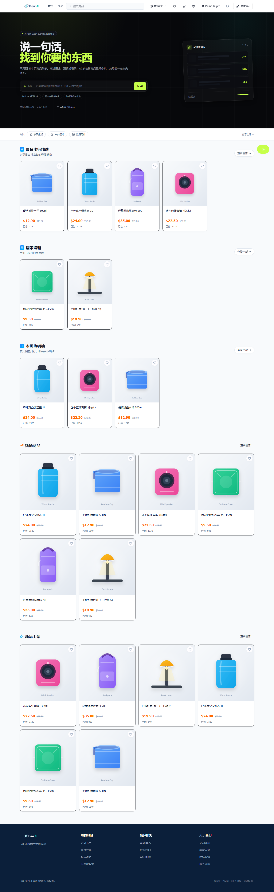

---

## 你会得到什么

| | 买家商城 | 卖家 AI 工作台 |
|---|---|---|
| **面向** | 海外消费者，四种语言（en / zh / es / pt） | 经营店铺的商家 |
| **核心** | 搜索、筛选、SKU 规格、购物车、优惠券、结算、物流、退款、评价 | 看板、商品、订单、退款、集合、优惠券、CMS、审计、AI |
| **AI** | 导购：先推荐，加购前必须确认 | 五个专业 Agent + 带人工审批的工具调用副驾 |

**不配置任何 AI Key 也能完整使用。** 所有非 AI 功能正常运行；AI 端点诚实返回「请填写模型」，绝不返回假数据。

---

## 差异化在哪里

多数开源电商项目要么只有商城，要么只有后台。Flow 在同一套数据模型上同时交付两者，并且把 AI 写进运营闭环，而不是挂一个聊天窗口。

### 1. 会干活，但绝不擅自干

对它说「把低库存商品清仓」，它会查低库存、建清仓券、下架滞销品，把整串动作**合成一个待审批批次**，一次批准按序执行，失败即停。

```
卖家自然语言
   └─ Agent 规划多步工具调用
        ├─ 只读工具 → 直接查本店真实数据
        └─ 写工具   → copilot_actions(status = pending)
              └─ 卖家批准 → 走既有业务服务
                 （状态机 / 库存 / 积分 / 审计保持一致）
```

- **12 个工具**：店铺概况、订单、商品、低库存、待批退款、状态流转、退款审批、上下架、建券、建草稿、回复咨询
- **参数强校验**：每个工具声明类型 / 枚举 / 范围 / 长度，未知参数一律拒绝，挡住模型幻觉与参数注入
- **归属校验**：读工具按卖家隔离，写工具执行前二次校验归属，管理员保留跨店权限
- **全链路留痕**：对话、工具结果、动作、执行结果逐条落库

### 2. 五个真实 Agent，不是五个按钮

| Agent | 做什么 | 关键实现 |
|---|---|---|
| **Copywriter** | 标题 / 卖点 / 长描述 / SEO 关键词 | 强制 JSON 输出，写回多语言字段 |
| **Support** | 智能客服 | FAQ 政策匹配 + 商品检索 + 订单摘要，先查真实数据再回答 |
| **Trend** | 销售分析 | 近 30 天 SQL 聚合 + LLM 解读，报告落库 |
| **Select** | 选品建议 | 类目 + Top 20 热销 + 库存上下文，输出结构化推荐 |
| **Translation** | 多语言翻译 | 12 种目标语言，按跨境场景调优 |

全部经同一网关收口，统一处理服务商差异（推理模型 token 预算、响应字段回退、带版本段的 Base URL）。用量按每次调用、按 Agent 计量。

### 3. 真正被执行的护栏

| 边界 | 行为 |
|---|---|
| 租户隔离 | 所有卖家侧查询强制作用域，管理员保留跨店视图 |
| 模型配置 | 密钥按 `userId:` 存储，任何卖家读不到、也覆盖不了他人配置 |
| 演示支付 | 仅 `development` / `test` 放行，生产环境一律 403，任何开关都不能绕过 |
| 出站请求 | webhook、通知地址、LLM Base URL 统一拒绝环回 / 私网 / CGNAT / 链路本地 / 云元数据，并绑定 DNS 解析结果、不跟随重定向 |
| 上架门禁 | 六项完整性校验（图片、库存、文案、类目、价格、规格）全部通过才允许上架 |

---

## 产品截图

### 买家商城

| 首页（英文） | 首页（中文） |
|:---:|:---:|
| 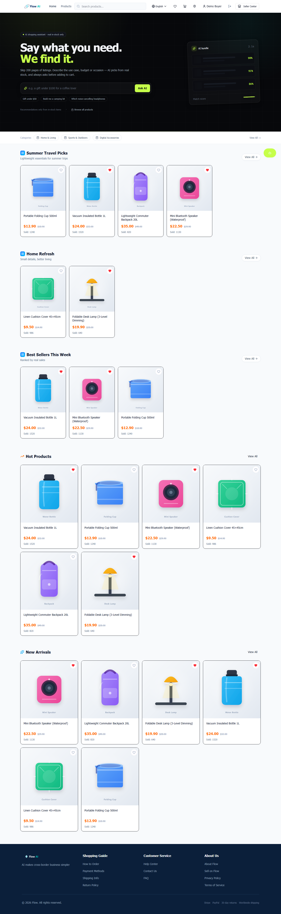 |  |
| **商品列表** | **商品详情** |
| 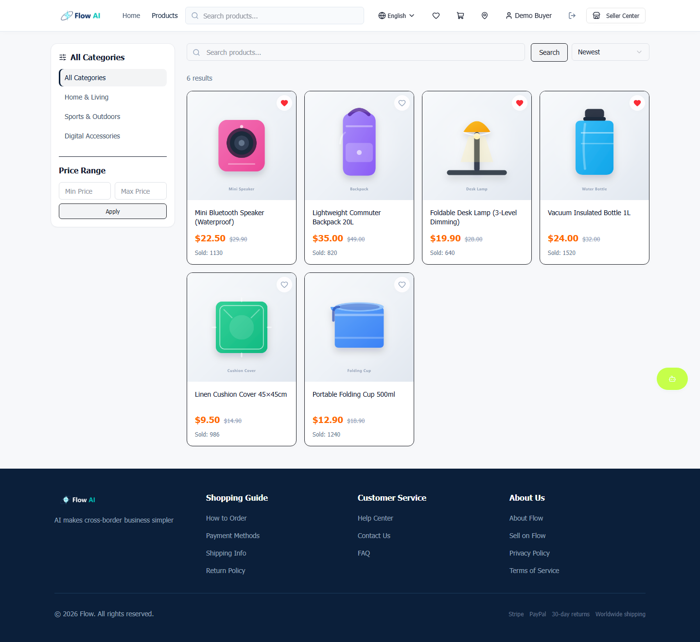 | 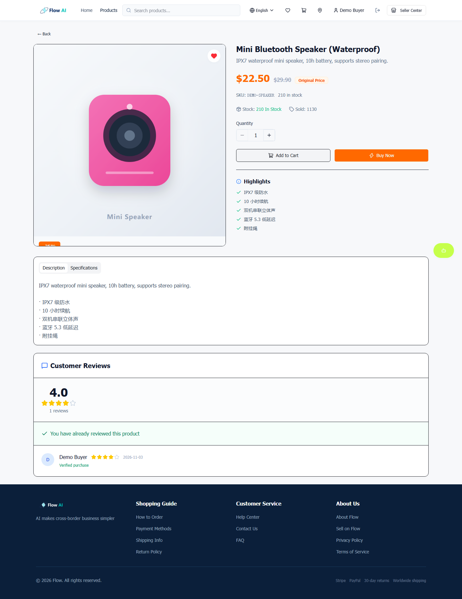 |
| **购物车** | **结算** |
| 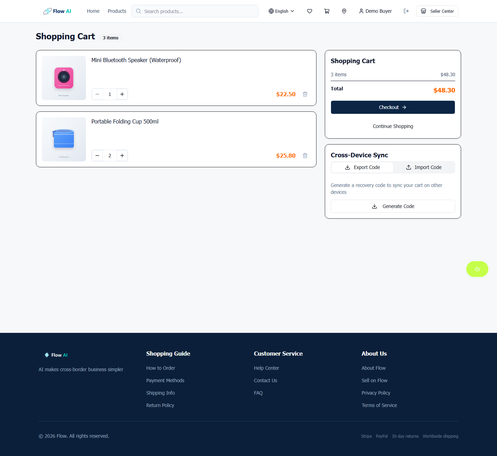 | 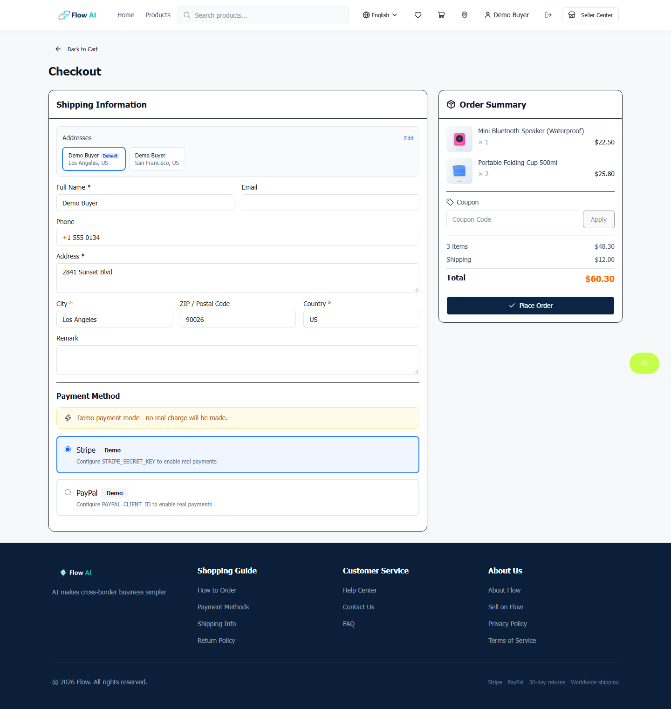 |
| **订单跟踪** | **运营楼层** |
| 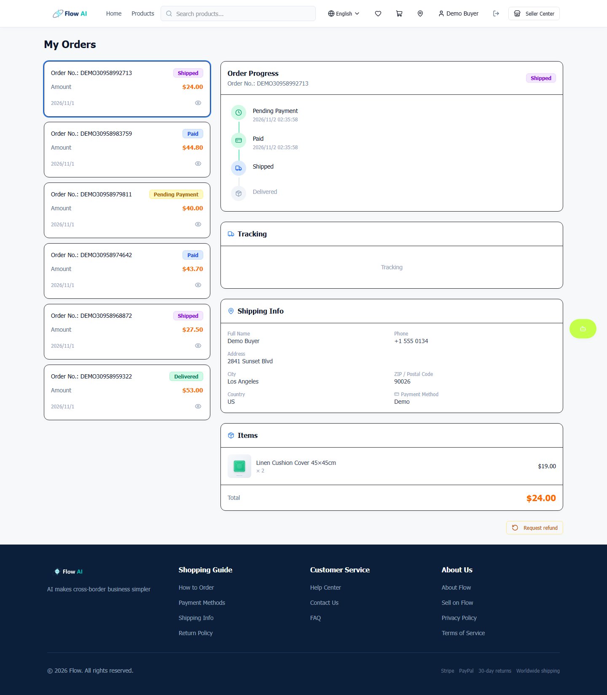 | 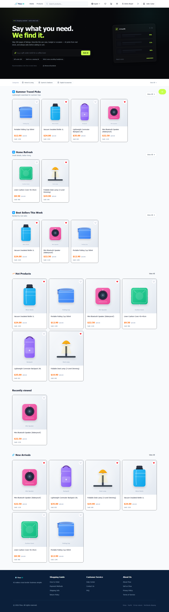 |

### 卖家工作台

| 数据看板 | AI 运营副驾 |
|:---:|:---:|
| 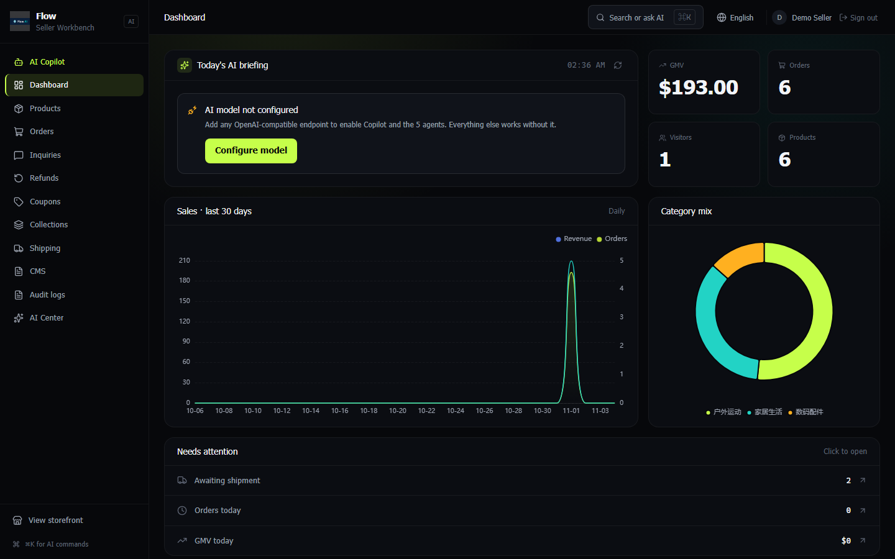 | 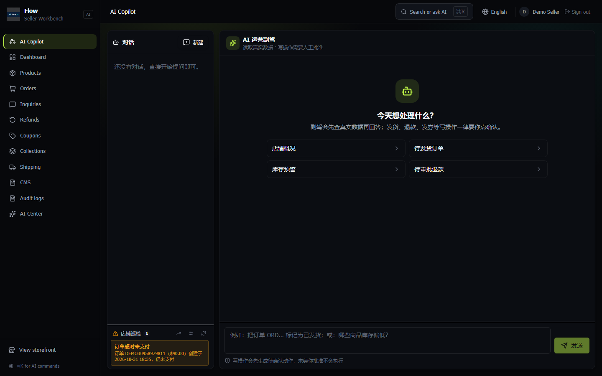 |
| **商品管理** | **订单管理** |
| 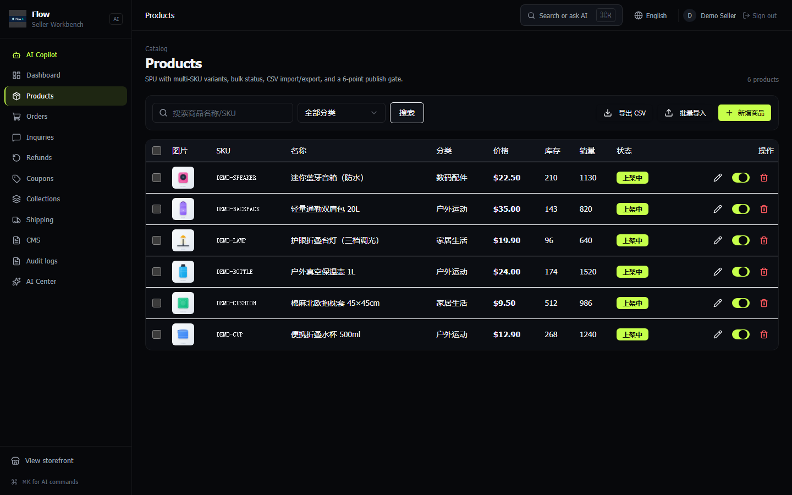 | 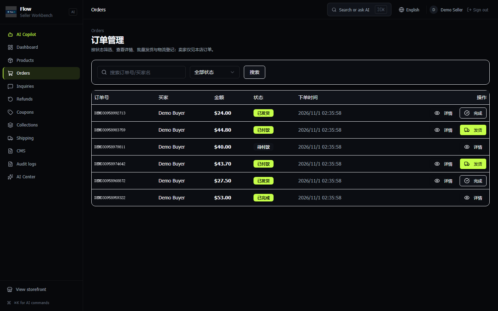 |
| **AI 分析中心** | **退款管理** |
| 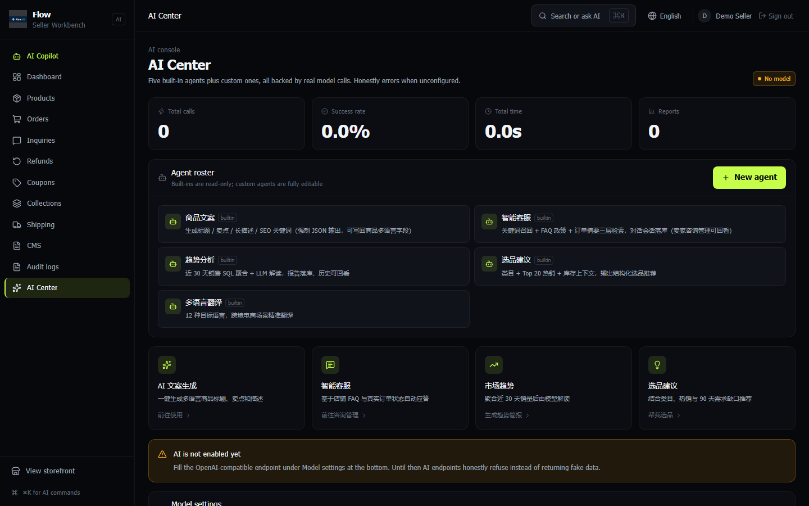 | 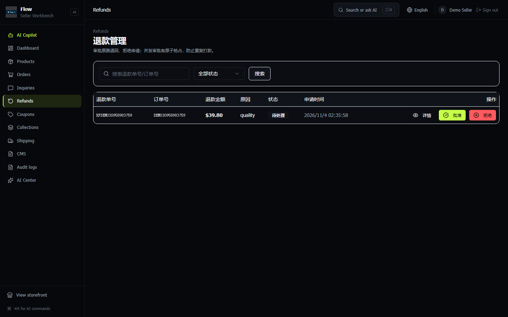 |

全部 31 张截图在 [`docs/screenshots/`](docs/screenshots)，由 `npm run capture:all` 针对真实数据库重新生成，不会与代码脱节。仓库社交预览图由 `npm run capture:social` 渲染。

---

## 快速开始

### Docker（推荐）

```bash
git clone https://github.com/X33834/Flow.git
cd Flow
cp .env.example .env          # 必须替换 JWT_SECRET 与 POSTGRES_PASSWORD
docker compose up -d --build
```

- 买家商城 → <http://localhost:3000/>
- 卖家工作台 → <http://localhost:3000/seller/dashboard>

Compose 强制 `NODE_ENV=production`，该环境拒绝演示数据播种。需要演示数据请用下面的本地方式搭配独立空库。

### 本地开发

```bash
npm ci
cp .env.example .env   # 填 DATABASE_URL 与 JWT_SECRET，NODE_ENV=development
npm run db:migrate
npm run dev            # Vite + NestJS 同时启动
```

### 跑完整测试

```bash
npm run lint && npm run type:check && npm test && npm run build
npm run smoke:all      # 六套端到端，跑在真实 PostgreSQL 上
```

本机已有 PostgreSQL（无 Docker）时，指向一个可丢弃的数据库即可：

```bash
E2E_DATABASE_URL=postgresql://user:pw@127.0.0.1:5432/flow_e2e_local npm run smoke:all
```

库名不含 `e2e` / `smoke` / `test` 时 runner 会直接拒绝执行。

### 命令行（集成与运维）

```bash
FLOW_BASE=http://127.0.0.1:3000 npm run cli -- health
FLOW_BASE=http://127.0.0.1:3000 npm run cli -- products --limit 5
FLOW_BASE=http://127.0.0.1:3000 npm run cli -- openapi openapi.json
```

---

## 配置 AI

在 **卖家工作台 → AI 分析中心 → 模型设置** 填写，保存即生效，无需重启。

| 字段 | 说明 |
|---|---|
| Base URL | 任意 OpenAI 兼容端点：DeepSeek、火山方舟、OpenAI、通义、智谱…… |
| API Key | 只存数据库，界面掩码展示，不回显明文 |
| 模型名 | 如 `deepseek-chat`；推理模型自动提高 token 预算 |

优先级：**界面设置 → `LLM_*` 环境变量 → 未配置（诚实报错）**。

> `npm run mock:providers` 是本地替身，替代 Stripe、PayPal 与模型端点。它的签名回调只能证明接线正确，不代表服务商沙箱兼容。真实沙箱验收步骤见[部署指南](docs/DEPLOY.md)。

---

## 工程质量

| 维度 | 现状 |
|---|---|
| 类型 | TypeScript strict；前后端共享 `shared/api.interface.ts` 单一契约 |
| 模块 | 25 个 NestJS 模块、25 个 controller、155 个端点、39 张表、9 个 SQL 迁移 |
| 测试 | 286 个用例 / 45 个文件（金额、退款、运费、状态机、验签、租户、搜索、SEO、通知） |
| E2E | 六套：工作流 16 步、无 Key 降级、交易 19 步、渠道 18 步、副驾 19 步、导购 9 步 |
| 浏览器 QA | `npm run qa:journey` 用真实浏览器走遍买家与卖家全部路由，任何控制台错误、请求失败或内容缺失都判失败 |
| CI | lint → typecheck → 单测+覆盖率 → 生产依赖审计 → 构建 → Postgres E2E |
| 安全 | HttpOnly Cookie JWT、CSRF 头校验、按端点限流、Stripe/PayPal 验签、租户隔离、SSRF 与重放防护 |
| 可观测 | 请求 ID、全局异常脱敏、结构化错误、AI 用量计量 |
| 可集成 | OpenAPI 3.1（`/api/openapi.json`）、`sitemap.xml`、`robots.txt`、`llms.txt` |

---

## 架构

```
┌──────────────────────────── 浏览器 ─────────────────────────────┐
│  React 19 + Vite + Tailwind + shadcn/ui + ECharts                │
│  买家商城  /              卖家工作台  /seller/*                  │
└───────────────────────┬──────────────────────────────────────────┘
                        │ HttpOnly JWT Cookie · X-Requested-With
┌───────────────────────▼──────────────────────────────────────────┐
│ NestJS 12 (Express 5) · ValidationPipe · RolesGuard              │
│ Auth · Products · Cart · Orders · Payments · Refunds · Coupons   │
│ Shipping · Collections · CMS · Reviews · Inquiry · Dashboard     │
│ AI（5 Agent + Gateway）· Copilot（12 工具 + 审批）               │
│ Shopper guide · SEO · Audit · Health                             │
└──────────┬──────────────────────────────┬────────────────────────┘
           │                              │
   ┌───────▼────────┐           ┌─────────▼──────────────────────┐
   │ PostgreSQL 16  │           │ OpenAI 兼容模型端点            │
   │ Drizzle ORM    │           │ Stripe · PayPal · 17TRACK      │
   │ pg_trgm 搜索   │           │ Google OAuth                   │
   └────────────────┘           └────────────────────────────────┘
```

表结构、AI 网关、Copilot 协议与安全模型见 [docs/ARCHITECTURE.md](docs/ARCHITECTURE.md)。

---

## 设计取舍

Flow 刻意选择「单进程 + REST」，优先保证交易正确性与租户隔离，而不是堆基础设施。

| 参照 | 借鉴了什么 | 刻意没照搬 |
|---|---|---|
| **Medusa / Saleor / Vendure** | 模块边界、多租户、可组合 commerce | 不做 GraphQL 重写，不引入重型容器拓扑 |
| **Shopify Hydrogen** | 店面 SEO、sitemap/robots、性能预算 | 不绑定托管平台：Vite SPA + 服务端 SEO 注入 |
| **Dify / FastGPT** | Agent 配置体验、用量面板、检索式上下文 | 不做通用 Agent 平台 |
| **Agentic commerce（UCP / ACP / AP2）** | `llms.txt`、机器可读 API、细粒度能力边界 | 支付授权协议尚不成熟，先落地只读发现层 + 人工审批写操作 |

**明确不做**：多租户 SaaS 计费、插件市场、GraphQL 重写。三者都会稀释「审批式副驾」这个真正的差异化。

---

## 文档

| 文档 | 内容 |
|---|---|
| [docs/ARCHITECTURE.md](docs/ARCHITECTURE.md) | 架构、数据库表、AI 网关、Copilot 协议、安全模型 |
| [docs/AI-AGENTS.md](docs/AI-AGENTS.md) | 五个 Agent、自定义 Agent、Copilot 工具与降级行为 |
| [docs/DEPLOY.md](docs/DEPLOY.md) | 部署、密钥清单、备份升级、排障 |
| [docs/ROADMAP.md](docs/ROADMAP.md) | 已交付、下一阶段、明确不做 |
| [docs/RELEASE-NOTES.md](docs/RELEASE-NOTES.md) | 当前版本发布说明与已知边界 |
| [CHANGELOG.md](CHANGELOG.md) | 版本历史（Keep a Changelog） |
| [CONTRIBUTING.md](CONTRIBUTING.md) | 贡献流程与代码规范 |
| [SECURITY.md](SECURITY.md) | 安全策略与漏洞报告 |

---

## 项目状态

| 项 | 值 |
|---|---|
| 当前版本 | **v1.23.0** |
| 状态 | 功能闭环，维护模式：修 bug、打安全补丁、升级依赖 |
| CI | GitHub Actions 执行 lint、typecheck、单测+覆盖率、生产依赖审计、构建、六套 Postgres E2E |
| 测试 | 286 / 286（45 文件） |
| 许可 | MIT |

---

## 贡献

欢迎 Issue / PR / 文档修正。开始前请阅读 [CONTRIBUTING.md](CONTRIBUTING.md) 与 [CODE_OF_CONDUCT.md](CODE_OF_CONDUCT.md)。

如果这个项目对你有帮助，**Star** 是最好的支持。

## License

[MIT](LICENSE) © 2026 Flow
